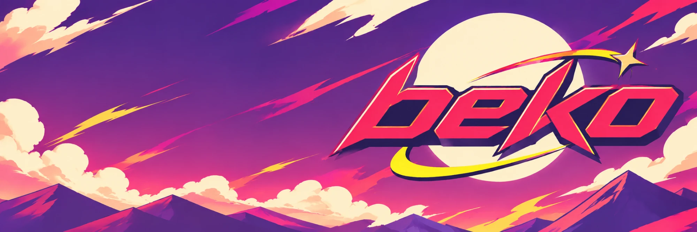
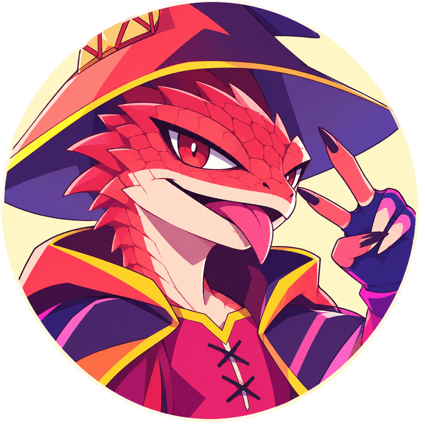
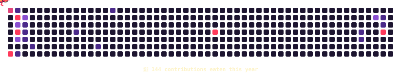

  

  

  
  
  

---

<table>
<tr>
<td width="62%" valign="top">

### 🦎 About me

- 💻 **Full-stack JavaScript** dev: websites with **Astro** and **Next.js**, **Discord bots** with discord.js
- 🦀 I also write **Rust** when performance matters
- 🗄️ I manage **databases** and **Redis** caching
- 🎙️ Studied **real-time voice processing** and I deploy **LiveKit** and **mediasoup** (WebRTC)
- 🏗️ Studied **social network architecture**: scalability, real-time, service design

</td>
<td width="38%" align="center">
  
</td>
</tr>
</table>

### 🛠️ Stack

**Languages**

  
  
  

**Web**

  
  
  

**Data**

  
  

**Real-time & voice**

  
  
  

### 🚀 Projects

  

### 📊 Stats

  
  

  

  

### 🦎 The lizard is hungry

<picture>
  <source media="(prefers-color-scheme: dark)" srcset="https://raw.githubusercontent.com/itsbeko/itsbeko/refs/heads/output/lizard-dark.svg" />
  <source media="(prefers-color-scheme: light)" srcset="https://raw.githubusercontent.com/itsbeko/itsbeko/refs/heads/output/lizard.svg" />
  
</picture>

Made with 🦎 by Beko

